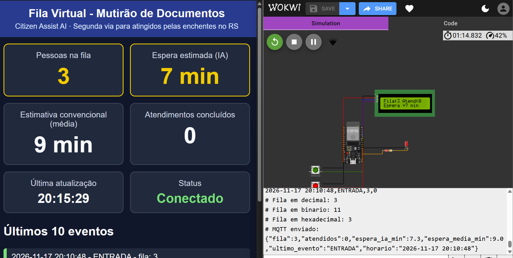

# Fila Virtual Inteligente - Citizen Assist AI

Global Solution 2026.2 · Arquitetura e Organização de Computadores · 1º ano de Ciência da Computação (FIAP)

| Nome | RM |
|---|---|
| Gabriela Angel Silva | 570808 |
| Izabelly Menezes | 570673 |
| Marcos Paulo Sampaio | 573987 |

## Sobre o projeto

Depois das enchentes de 2024 no RS, muita gente precisou ir a mutirões para tirar a segunda via de documentos, e ninguém sabia quanto tempo ia esperar na fila. A gente montou um protótipo de fila virtual para isso.

Um ESP32 conta quem chega (botão verde) e quem foi atendido (botão vermelho), mostra a fila num LCD e calcula a espera de dois jeitos: pela média dos atendimentos e por uma regressão linear que treinamos em Python. Os dados vão por MQTT para um painel que abre no navegador, inclusive no celular.

É um projeto acadêmico, não é um canal oficial. Os dados usados para treinar a IA são simulados.

- Simulação no Wokwi: https://wokwi.com/projects/480894213359412225
- Vídeo de demonstração: https://youtu.be/YNHptjB_7PQ?si=d5jzelq43oxGivOz
- Relatório técnico (com os testes): [docs/relatorio_tecnico.md](docs/relatorio_tecnico.md)
- Diagrama de arquitetura: [docs/diagrama_arquitetura.md](docs/diagrama_arquitetura.md)

## Como rodar

1. Abra o link do Wokwi acima e clique em Play. O Wi-Fi pode levar alguns segundos para conectar; quando aparecer "MQTT conectado!" no Serial Monitor, está funcionando. Se a rede não conectar, a fila funciona offline.
2. Abra o arquivo `painel/index.html` no navegador (é só dar dois cliques).
3. Na simulação, clique no botão verde para adicionar uma pessoa e no vermelho para concluir um atendimento. O painel atualiza junto.

Atalhos no Wokwi: a tecla 1 é o botão verde e a tecla 2 é o vermelho. Segurando as duas juntas por 3 s, a fila é zerada. Digitando `r` no Serial Monitor, a placa reinicia (usamos isso para testar se a fila fica salva na Flash).

Se quiser montar o projeto do zero, crie um projeto ESP32 no Wokwi, cole o `wokwi/sketch.ino` e o `wokwi/diagram.json` e adicione as bibliotecas LiquidCrystal I2C e PubSubClient. O tópico MQTT tem que ser o mesmo no sketch e no painel.

Para a parte da IA, abra `previsao/previsao_espera.ipynb` no Jupyter, VS Code ou Colab e rode todas as células (precisa de pandas, scikit-learn e matplotlib). O notebook gera os dados simulados e mostra os coeficientes que usamos no ESP32.

## Arquivos

- `wokwi/`: código do ESP32 (`sketch.ino`), circuito (`diagram.json`) e bibliotecas
- `painel/index.html`: painel web que recebe os dados por MQTT
- `previsao/`: notebook da regressão linear e os dados simulados
- `docs/`: relatório técnico, diagrama de arquitetura e prints dos testes
