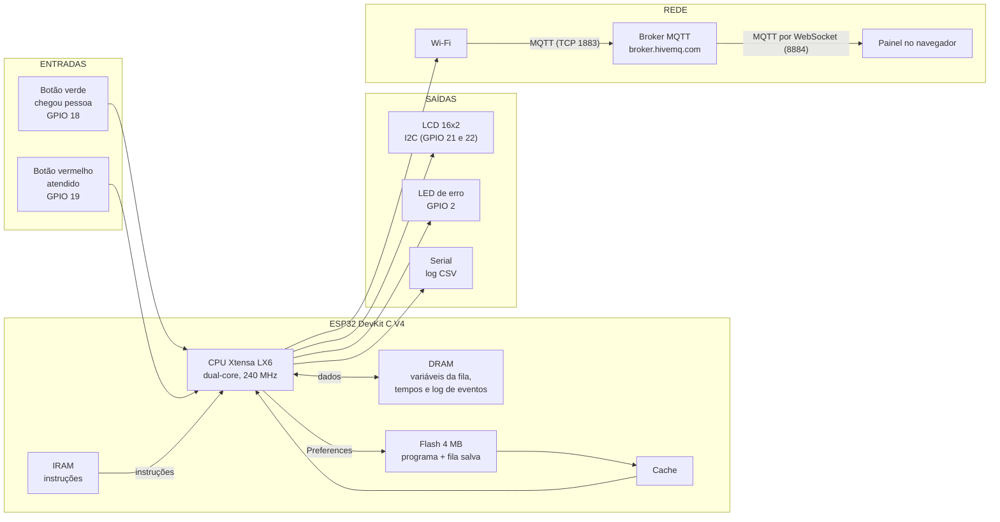

# Diagrama de arquitetura

Quando alguém aperta um botão, o pino vai de HIGH para LOW e a CPU trata o clique: atualiza a fila na DRAM, salva a fila na Flash e calcula a espera. Depois disso ela atualiza o LCD pelo I2C, escreve o evento no Serial e, se estiver conectada, publica um JSON no broker MQTT. O painel está inscrito no mesmo tópico e mostra os dados assim que recebe.

As instruções e os dados chegam à CPU por caminhos separados (IRAM e DRAM), por isso o ESP32 é considerado Harvard modificada. Isso está explicado no relatório, na parte de análise da arquitetura.
