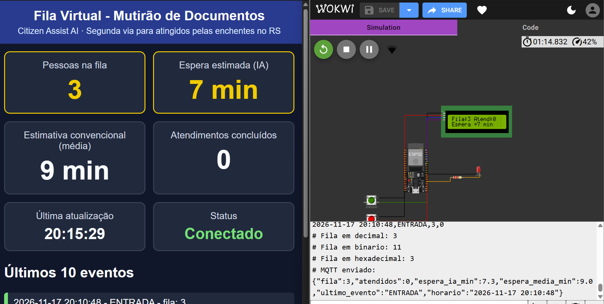
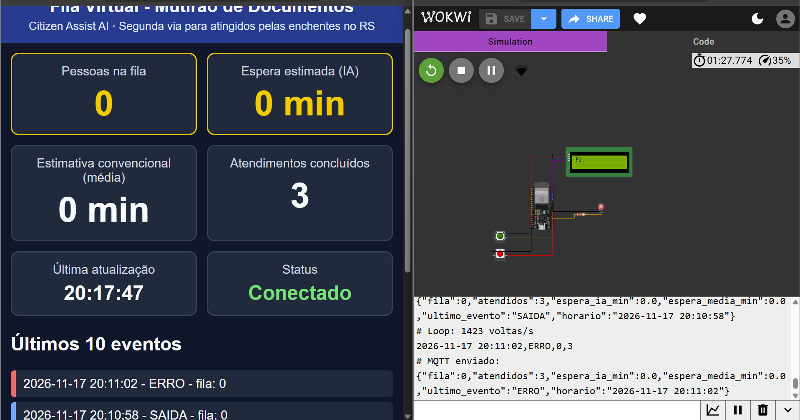
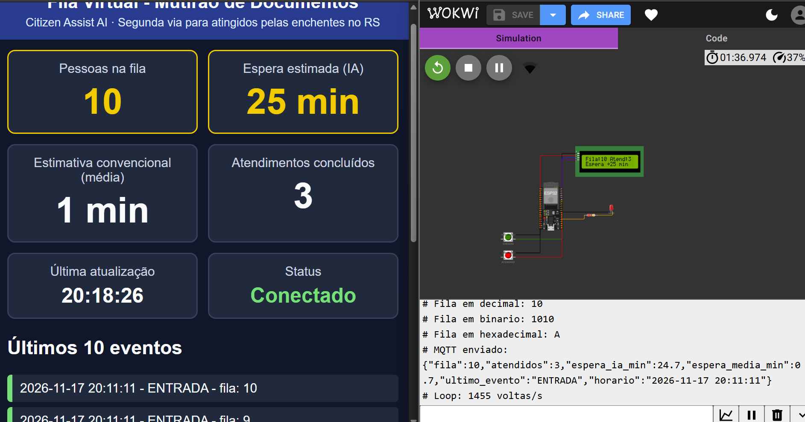
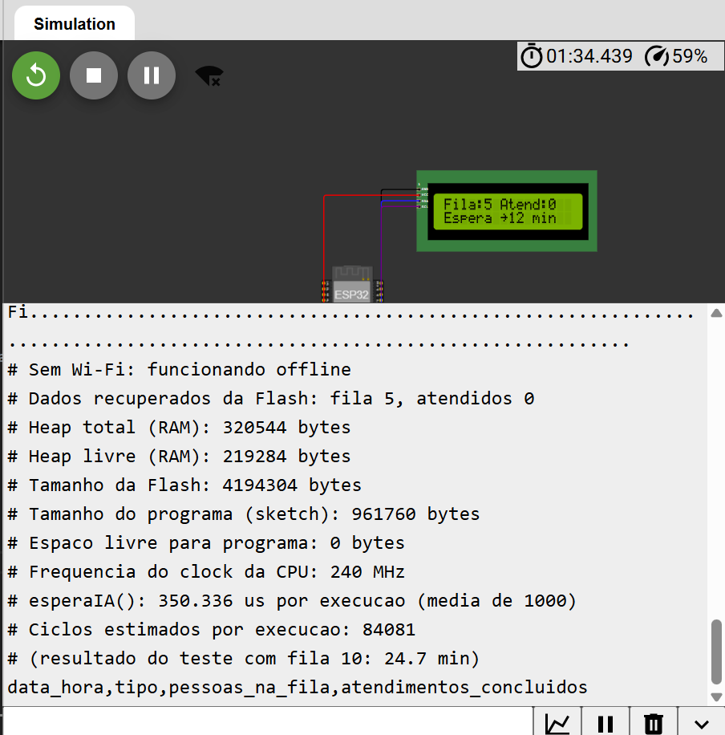
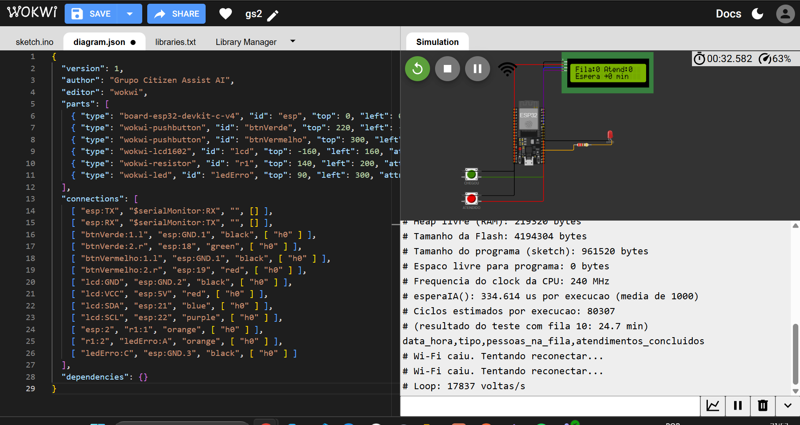
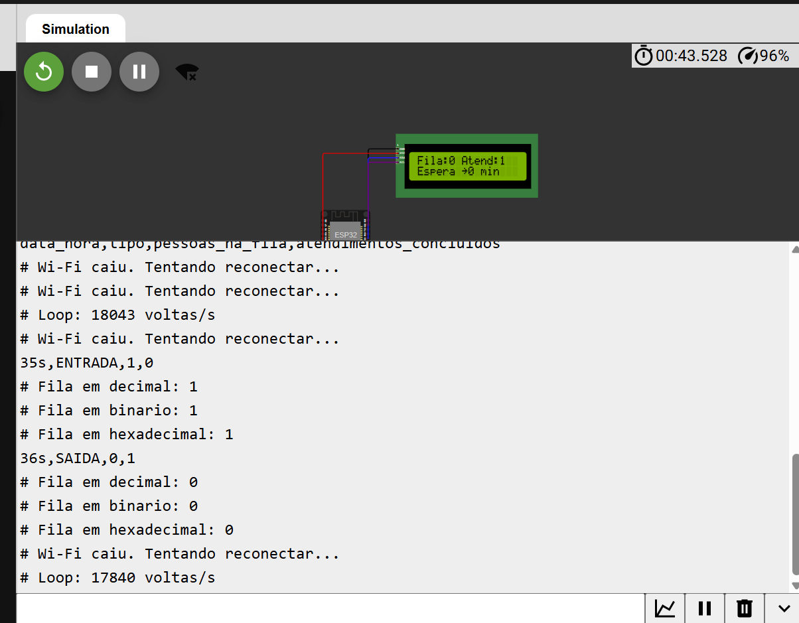

# Relatório técnico - Fila virtual inteligente

Global Solution 2026.2 · Arquitetura e Organização de Computadores
Gabriela Angel Silva (570808), Izabelly Menezes (570673) e Marcos Paulo Sampaio (573987)

## 1. O problema

Nas enchentes de 2024 no Rio Grande do Sul muita gente perdeu os documentos e teve que ir a mutirões para tirar a segunda via. Nesses lugares a fila é grande e a pessoa não tem ideia de quantos estão na frente nem de quanto tempo vai esperar. Nosso protótipo resolve isso: ele conta a fila, estima a espera e mostra as informações num display e num painel que abre no celular.

## 2. Arquitetura

Usamos um ESP32 simulado no Wokwi, programado em C++ (Arduino). O diagrama está em [diagrama_arquitetura.md](diagrama_arquitetura.md) e a simulação em https://wokwi.com/projects/480894213359412225.

| Parte | O que usamos |
|---|---|
| Entrada | Botão verde (GPIO 18) e botão vermelho (GPIO 19) |
| Processamento | ESP32 DevKit C V4, CPU Xtensa LX6 |
| Memória | DRAM para as variáveis e o log; Flash para o programa e a fila salva |
| Saída | LCD 16x2 por I2C, LED vermelho (GPIO 2) e Serial |
| Comunicação | Wi-Fi e MQTT (broker.hivemq.com) |
| Visualização | Painel web (`painel/index.html`) |

## 3. Como a fila funciona

Quando o botão verde é apertado, a fila aumenta em 1 e o programa registra um evento ENTRADA. O botão vermelho diminui a fila, soma um atendimento concluído e registra SAIDA. Se apertarem o vermelho com a fila vazia, a fila não fica negativa: o LED vermelho acende por 1 s, o LCD mostra "Fila vazia!" e o evento registrado é ERRO.

Os botões usam `INPUT_PULLUP`, então ficam em HIGH soltos e vão para LOW quando apertados. Para um clique não contar várias vezes por causa do repique do contato, fizemos um debounce de 200 ms com `millis()`.

Cada evento é guardado num vetor circular de 20 posições (tipo, horário e tamanho da fila) e aparece no Serial em formato CSV. O horário vem da internet pelo NTP. A cada ENTRADA ou SAIDA, a fila e os atendimentos também são gravados na Flash com a biblioteca Preferences, então, se a placa reiniciar, ela volta com os mesmos números.

Se não houver Wi-Fi, o `setup()` espera no máximo 30 s e continua sem rede. A fila funciona normalmente offline, e o `loop()` tenta conectar de novo a cada 30 s.

O LCD mostra `Fila:X Atend:Y` na primeira linha e a espera estimada pela IA na segunda. Pelo MQTT, o ESP32 manda um JSON sempre que algo muda e também a cada 10 s.

## 4. Previsão do tempo de espera

O enunciado pedia para comparar uma estimativa convencional com uma feita por IA.

- Convencional: número de pessoas na fila vezes a média dos últimos 20 atendimentos. Enquanto não há histórico, usamos 3 min por pessoa.
- IA: uma regressão linear treinada no notebook `previsao/previsao_espera.ipynb`.

Como não tínhamos dados reais de um mutirão, geramos 300 registros simulados de um dia de atendimento (8h às 17h). Nos horários de pico (10h às 12h e 14h às 16h) cada pessoa leva 3,5 min e fora do pico 2,5 min, com um pouco de ruído. Usamos 80% para treinar e 20% para testar.

A fórmula ficou `espera = 2,4998 × pessoas + 1,0157 × pessoas_no_pico − 0,2486`, em que `pessoas_no_pico` é o número de pessoas se for horário de pico e 0 se não for. Ou seja, cerca de 2,5 min por pessoa fora do pico e 3,5 min no pico.

| Método | Erro médio (MAE) nos dados de teste |
|---|---|
| Convencional | 7,53 min |
| Regressão linear | 1,52 min |

Na primeira versão a gente usou a hora do dia direto como entrada. O erro foi de 6,03 min e, para 1 pessoa na fila, o modelo previa −3 min, o que não faz sentido. Trocamos para a entrada "pessoas no pico" e o problema sumiu.

Sabemos que a IA acertou tanto porque os dados foram gerados com essa mesma regra. Com dados reais, o modelo precisaria ser treinado de novo.

## 5. Comunicação

- I2C entre o ESP32 e o LCD: dois fios, SDA (GPIO 21) e SCL (GPIO 22). O LCD tem o endereço 0x27.
- UART (Serial a 115200 bps) para o log.
- Wi-Fi 802.11 na rede do Wokwi. Por cima dele, TCP/IP até o broker na porta 1883.
- MQTT, que funciona por publish/subscribe: o ESP32 publica no tópico `citizenassist/fila/gs2026-1ccfev-x7k3` e o broker repassa para quem assinou o tópico. A mensagem vai como retida, então quem abre o painel depois já recebe o último estado.
- O navegador não abre conexão TCP direto na porta 1883, por isso o painel usa MQTT por WebSocket seguro (porta 8884), com a biblioteca mqtt.js.
- NTP para pegar o horário real (UTC−3).

## 6. Análise da arquitetura

### 6.1 Processador

O ESP32 tem uma CPU Xtensa LX6 de dois núcleos que chega a 240 MHz, cerca de 520 KB de SRAM e, na nossa placa, 4 MB de Flash. Ele já vem com Wi-Fi e Bluetooth.

Na aula vimos as arquiteturas Von Neumann e Harvard. Na Von Neumann, instruções e dados ficam na mesma memória e passam pelo mesmo barramento, então a CPU pega um de cada vez (o gargalo de Von Neumann). Na Harvard, as memórias e os barramentos são separados. O ESP32 é uma Harvard modificada: a CPU busca instruções na IRAM e dados na DRAM ao mesmo tempo, mas o programa fica guardado na Flash e chega à CPU passando por uma cache.

Os barramentos internos são de três tipos: o de dados leva os valores, o de endereços diz em que posição da memória ler ou gravar e o de controle diz se é leitura ou escrita e quando.

### 6.2 Memória

Fizemos uma estimativa de quanto as nossas variáveis ocupam na DRAM:

| Variáveis | Bytes |
|---|---|
| Fila, atendimentos e contadores (`int` e `unsigned long`) | 28 |
| `tempos_atendimento[20]` (float) | 80 |
| `eventos[20]` (struct de 32 bytes cada) | 640 |
| Debounce, erro e controle do MQTT | 34 |
| 2 `String` | ~72 |
| Total | ≈ 854 |

E estes são os valores que o próprio ESP32 mostrou no Serial:

| Medida | Valor |
|---|---|
| Heap total | 320.552 bytes |
| Heap livre | 219.320 bytes |
| Flash | 4.194.304 bytes (4 MB) |
| Tamanho do programa | 961.760 bytes |

O heap usado é de 101.232 bytes, bem mais que os nossos 854 bytes (cerca de 0,27% do heap). Quase tudo vem das bibliotecas de Wi-Fi, TCP/IP e MQTT. O programa ocupa uns 23% da Flash, e a maior parte também é biblioteca. O Wokwi mostrou 0 bytes de espaço livre para programa; entendemos que isso é uma limitação do simulador, que não tem a mesma divisão da Flash que a placa real.

Sobre a hierarquia de memória: os registradores e a cache são os mais rápidos e menores, depois vem a SRAM (onde ficam as variáveis) e por último a Flash, que é a mais lenta, mas não perde os dados sem energia. No nosso projeto a Flash faz o papel de memória secundária, como um HD ou SSD faria num computador. A diferença é que ela não tem partes móveis, como o SSD, e é bem menor. Ela também aguenta um número limitado de gravações; gravar a cada clique serve para o protótipo, mas num uso real seria melhor gravar de tempos em tempos.

### 6.3 Entrada, processamento e saída

- Entrada: leitura dos GPIO 18 e 19 com pull-up interno e debounce.
- Processamento: atualizar a fila, calcular as duas estimativas, gravar na Flash e montar o JSON.
- Saída: LCD por I2C, LED no GPIO 2 (com resistor de 220 Ω), Serial e MQTT.

O `loop()` não usa `delay()`. Tudo é controlado com `millis()`, para a leitura dos botões e a conexão não travarem uma à outra.

### 6.4 Base numérica

O programa mostra no Serial a fila em decimal, binário e hexadecimal a cada evento. Por exemplo, com 10 pessoas apareceu `1010` em binário e `A` em hexadecimal.

O endereço do LCD é 0x27. Em decimal: 2 × 16 + 7 = 39. Em binário, dividindo 39 por 2 várias vezes e lendo os restos de baixo para cima, dá 100111, ou 0010 0111 com 8 bits. Dá para conferir pelo hexadecimal, porque 2 = 0010 e 7 = 0111.

O `int` do ESP32 tem 32 bits, então o maior valor é 2³¹ − 1 = 2.147.483.647. A fila nunca vai chegar nisso. A `struct Evento` tem 8 + 20 + 4 = 32 bytes (256 bits), e o vetor de 20 eventos tem 640 bytes.

Soma binária de quando a fila tinha 5 pessoas e chegaram mais 3:

```
  vai um:  1 1 1
           0 1 0 1   (5)
         + 0 0 1 1   (3)
           -------
           1 0 0 0   (8)
```

### 6.5 Desempenho

O programa mede o tempo com `micros()`. Valores do Wokwi:

| Medida | Valor |
|---|---|
| Clock | 240 MHz (período de 1 ÷ 240.000.000 ≈ 4,17 ns) |
| Tempo da `esperaIA()` | entre 332 e 350 µs (ex.: 334,614 µs ≈ 80.307 ciclos) |
| Voltas do `loop()` sem Wi-Fi | cerca de 17.837 a 18.043 por segundo (≈ 56 µs por volta) |
| Voltas do `loop()` com Wi-Fi e MQTT | cerca de 1.423 a 1.675 por segundo (≈ 600 µs por volta) |

Achamos estranho a `esperaIA()` demorar 80 mil ciclos para uma conta simples. A maior parte desse tempo é a conversão do horário (`localtime_r`) para saber se é horário de pico, não a conta em si. Além disso, o simulador é mais lento que a placa de verdade.

Com a rede ligada o loop fica umas 10 vezes mais lento. Mesmo assim, durante um clique de uns 100 ms ele ainda dá cerca de 167 voltas, então nenhum clique se perde. Como medimos no simulador, esses números servem mais para comparar as situações do que como valor exato do hardware.

### 6.6 Limitações

- O broker MQTT é público, sem senha e sem criptografia, e usamos QoS 0, então uma mensagem pode se perder.
- Se o Wi-Fi cair, os eventos desse período não chegam ao painel (mas a fila continua funcionando). O Wi-Fi do Wokwi às vezes fica instável.
- Só a fila e os atendimentos ficam na Flash. O log e os tempos de atendimento se perdem num reinício.
- O debounce é simples e o tempo de atendimento depende de o atendente apertar o botão na hora certa.
- Sem internet não tem NTP, e aí o programa considera que o dia começou às 8h quando a placa ligou.
- A IA foi treinada com dados simulados.

## 7. Problemas que encontramos

O Wi-Fi não conectava no Wokwi. Testamos um código mínimo, só com o Wi-Fi, e ele conectou, então a internet estava ok. Com o nosso circuito na placa ESP32 DevKit V1 nem esse código mínimo conectava, por isso trocamos para a DevKit C V4 (mantendo os mesmos pinos). Depois fomos tirando as peças uma a uma e descobrimos que iniciar o LCD antes do Wi-Fi impedia a conexão; agora o Wi-Fi começa primeiro. Também paramos de desligar e religar o Wi-Fi a cada 5 s, porque isso cortava a conexão no meio.

Com o Wi-Fi funcionando, o MQTT caía de vez em quando. O simulador roda mais devagar que o tempo real e o broker achava que a placa tinha sumido, então aumentamos o keep alive de 15 para 60 s. Por último, o botão EN da placa não reinicia a simulação, e precisávamos reiniciar para testar a Flash. Criamos então o comando `r` no Serial, que chama `ESP.restart()`.

## 8. Testes

Fizemos os 7 testes na simulação do Wokwi, com o painel aberto ao lado. Todos funcionaram.

| Teste | O que fizemos | Resultado |
|---|---|---|
| 1. Chegada | Apertamos o verde 3 vezes | Fila 3 no LCD e no painel |
| 2. Atendimento | Apertamos o vermelho até a fila zerar | Fila 0 e 3 atendimentos, eventos SAIDA no painel |
| 3. Fila vazia | Apertamos o vermelho com a fila em 0 | A fila continuou 0, o LED acendeu e apareceu ERRO |
| 4. Estimativa | Fomos até 10 pessoas | A IA mostrou 24,7 min (fora do pico) e a fila em binário 1010 |
| 5. Persistência | Com a fila em 5, digitamos `r` para reiniciar | Depois do reinício a fila voltou como 5, lida da Flash |
| 6. Desempenho | Lemos as medidas no Serial | Valores da seção 6.5 |
| 7. Sem internet | O Wi-Fi do Wokwi ficou fora | A fila continuou contando entradas e saídas |

Alguns trechos do log:

```
2026-11-17 20:10:48,ENTRADA,3,0
2026-11-17 20:10:58,SAIDA,0,3
2026-11-17 20:11:02,ERRO,0,3
rst:0xc (SW_CPU_RESET)
# Dados recuperados da Flash: fila 5, atendidos 0
# Sem Wi-Fi: funcionando offline
35s,ENTRADA,1,0
36s,SAIDA,0,1
```

A estimativa convencional apareceu bem baixa nos testes (0,7 min com 10 pessoas). Isso acontece porque, na simulação, os "atendimentos" duram só alguns segundos entre um clique e outro. Num mutirão de verdade as duas estimativas ficariam na mesma escala.

Prints:

Testes 1 e 2 (fila 3, depois fila zerada com 3 atendimentos)


Teste 3 (LED aceso e evento ERRO)


Teste 4 (10 pessoas na fila)


Teste 5 (fila recuperada da Flash)


Teste 6 (memória e desempenho no Serial)


Teste 7 (funcionando sem Wi-Fi)


## 9. O que daria para melhorar

Usar um broker com senha e criptografia, treinar a IA com dados reais de um mutirão, ter mais de um guichê e senhas individuais para cada pessoa saber a sua posição, e avisar o cidadão quando faltar pouco para a vez dele.
